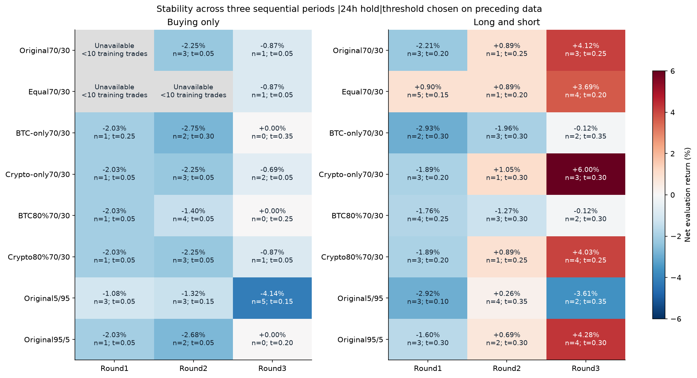

#  Crypto Sentiment Trading Bot

A BTC signal research and paper-trading prototype combining **AI-powered news sentiment analysis** with **technical analysis**. It collects news, records sentiment and technical scores, generates signals, and supports reproducible historical research.

---

## Research and backtesting

**[Research guide and executed notebooks](notebooks/README_recent.md)**

The project explores whether recorded news sentiment and technical scores can help identify subsequent BTC price movements. The published research uses **192 observations from September 24 to October 31, 2026**, with frozen Binance BTCUSDT hourly prices. Three disconnected June observations are excluded. Exported HOLD labels were collection placeholders; the experiments use continuous scores.

### Two different sets of weights

First, category weights combine Bitcoin, crypto, politics and war/macro into a **news score**. Then news and technical scores combine into the **P-score**. The original settings are 40/20/20/20 inside news, followed by 70% news / 30% technical. Research candidates change one of these layers explicitly. The experiments do not establish 70/30 as optimal or change the running bot configuration.

### What the analyses show

- **Category scores have weak descriptive relationships with future returns.** All 16 category/horizon pairs had Pearson and Spearman correlations below 0.10 in absolute magnitude at 1, 4, 12 and 24 hours. Correlation does not measure portfolio profitability. [Category study](notebooks/category_research/news_category_analysis.ipynb)
- **Higher return in one period did not reliably persist.** Of 21 news/technical mixes, 5/95 led the original earlier segment (+2.82%) but lost later (-4.66%). The mix with the highest later return was not the earlier winner. [Original weight study](notebooks/trading_strategy_research_recent.ipynb)
- **Equal category weights were positive in all three sequential long/short evaluations**, but only across ten completed trades. That makes them a candidate for further validation, not a proven optimal formula. [Sequential study](notebooks/category_research/sequential_stability_analysis.ipynb)



The table below shows long/short net returns after modeled costs. A threshold is chosen independently for each candidate using only data preceding each evaluation period, then held fixed within that period. Each period starts separately at $1,000.

| Candidate | Oct 13-20 | Oct 20-25 | Oct 25-31 | Trades across periods |
|---|---:|---:|---:|---:|
| Original categories, 70/30 news/TA | -2.21% | +0.89% | +4.12% | 3 / 1 / 3 |
| Equal categories, 70/30 news/TA | +0.90% | +0.89% | +3.69% | 5 / 1 / 4 |
| Bitcoin-only news, 70/30 | -2.93% | -1.96% | -0.12% | 2 / 3 / 2 |
| Crypto-only news, 70/30 | -1.89% | +1.05% | +6.00% | 3 / 1 / 3 |
| Bitcoin-heavy news, 70/30 | -1.76% | -1.27% | -0.12% | 4 / 3 / 2 |
| Crypto-heavy news, 70/30 | -1.89% | +0.89% | +4.03% | 3 / 1 / 4 |
| Original categories, 5/95 news/TA | -2.92% | +0.26% | -3.61% | 3 / 4 / 2 |
| Original categories, 95/5 news/TA | -1.60% | +0.69% | +4.28% | 3 / 2 / 4 |

Dates share boundary days but evaluation windows do not overlap; exact UTC boundaries are in the notebook. Training uses the first 96, 124 and 153 observations, followed by 28, 29 and 39 evaluation observations. The same short history has already been explored repeatedly, and the candidates were chosen after earlier research. These results are historical consistency checks, not independent validation. Do not add the three returns as if they represented a continuously traded account.

### Assumptions and current research direction

The latest trading comparisons use a 24-hour hold, one position at a time, entry at the next hourly open after a signal, 0.10% fee and 0.05% slippage on each side. Thresholds range from 0.05 to 0.55 in 0.05 steps and require at least ten completed training trades. Positions crossing a segment endpoint are excluded. Drawdown is measured at hourly opens.

Long/short results are hypothetical and unleveraged. Funding, borrowing availability/cost, margin, liquidation and intrahour execution are not modeled. Fixed-hold experiments do not validate the bot's stop-loss/take-profit behavior. Previous buying-only results are preserved, but future research focuses on long/short because buying-only performed poorly in this sample.

Forty newer recorded observations remain reserved and have not been evaluated for strategy performance. Their raw data and the credential-containing Azure source notebook are not included in this publication. The next research stage is to freeze selection rules and validate on later data and paper trading. **A reliable live-trading edge has not been established.**

---

## How It Works

```
Every hour (automated):

1. 📰 Fetch 400 crypto/BTC/political/macro news headlines
2. 🧹 Clean & deduplicate headlines (fuzzy matching)
3. 🧠 Analyze sentiment via LLM (Llama 3.3 70B)
4. 📊 Calculate RSI + Support/Resistance from Binance
5. ⚡ Compute composite score: P = News×0.7 + TA×0.3
6. 🚦 Generate signal: BUY / SELL / HOLD
7. 💾 Save to SQLite database
8. 📱 Send alert to Telegram
```

---

## Signal Formula

```
P = News Score × 0.7 + Technical Score × 0.3

News Score    = BTC×0.40 + Crypto×0.20 + Politics×0.20 + Macro×0.20
TA Score      = RSI Score×0.5 + Support/Resistance Score×0.5

P > +0.55  → BUY
P < -0.55  → SELL
else       → HOLD
```

---

## Project Structure

```
├── Analysis/
│   ├── SentimentAnalysis.py   # LLM sentiment scoring
│   ├── technical.py           # RSI + Support/Resistance
│   └── score.py               # P = News×0.7 + TA×0.3
├── bot/
│   └── risk.py                # Position sizing, stop-loss, take-profit
├── Cleaning/
│   └── Cleaning.py            # Regex cleaning + deduplication
├── data/
│   └── price.py               # Binance OHLCV fetcher
├── News/
│   └── NewsScrap.py           # Google News RSS scraper
├── notify/
│   └── telegram.py            # Telegram bot notifications
├── storage/
│   └── database.py            # SQLite — signals + paper trades
├── config.py                  # All settings in one place
└── main.py                    # Orchestrates full pipeline
```

---

## Setup

**1. Clone the repo**
```bash
git clone https://github.com/Saadmesbah/News-Trading.git
cd News-Trading
```

**2. Create virtual environment**
```bash
python -m venv .venv
.venv\Scripts\activate   # Windows
source .venv/bin/activate # Mac/Linux
```

**3. Install dependencies**
```bash
pip install -r requirements.txt
```

**4. Configure `.env`**
```bash
cp .env.example .env
# Fill in your API keys
```

**5. Run the bot**
```bash
python main.py
```

---

## Environment Variables

Create a `.env` file with:

```env
OPENROUTER_KEY=your_openrouter_api_key
TELEGRAM_TOKEN=your_telegram_bot_token
TELEGRAM_CHAT_ID=your_telegram_chat_id
```

Get your keys:
- **OpenRouter** → https://openrouter.ai
- **Telegram Bot** → @BotFather on Telegram

---

## Risk Management

| Parameter | Value |
|---|---|
| Capital | $1,000 (configurable) |
| Risk per trade | 2% |
| Stop-loss | 2% or nearest support |
| Take-profit | 4% (2:1 risk/reward) |

---

## Tech Stack

| Layer | Technology |
|---|---|
| Language | Python 3.11+ |
| News | Google News RSS + feedparser |
| Sentiment | Llama 3.3 70B via OpenRouter API |
| Price Data | Binance Public API |
| Database | SQLite |
| Notifications | Telegram Bot API |
| Scheduler | schedule |

---

## Author

**Mesbah Saad** — Data Science Student @ ESI  
[LinkedIn](https://linkedin.com/in/saad-mesbah-623466273) · [GitHub](https://github.com/Saadmesbah)