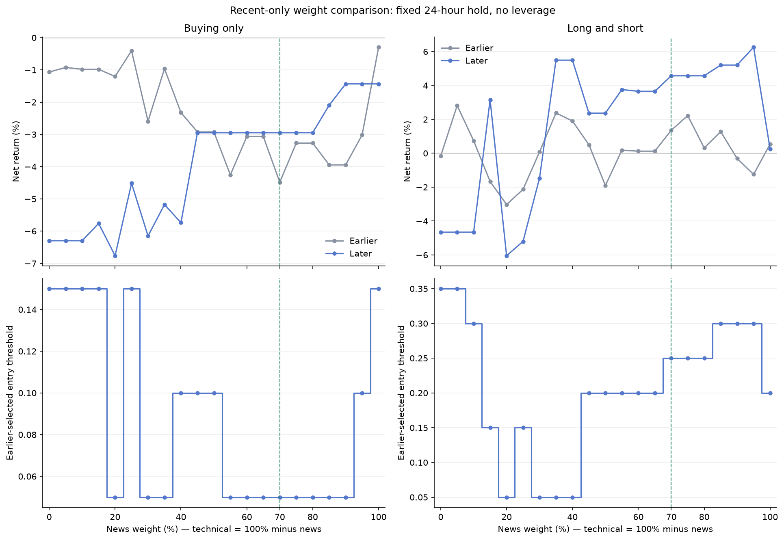

# BTC signal research: recent observations

[Open the executed notebook](trading_strategy_research_recent.ipynb)

This study uses **192 observations from September 24 to October 31, 2026**, excluding three disconnected June observations. Exported HOLD labels were collection placeholders; the analysis uses continuous scores.

## Included analyses

- Date, completeness and collection-gap audit.
- Bitcoin price and score charts, plus 1, 4, 12 and 24-hour forward-return correlations.
- Separate views for the original P-score, news score and technical score.
- Threshold and holding-period comparisons for each score, in buying-only and long/short simulations.
- Twenty-one news/technical weight combinations, using a fixed 24-hour hold and a threshold selected from earlier observations for each mix.

## Main finding

With the fixed 24-hour long/short comparison, the earlier-selected 5% news / 95% technical mix returned +2.82% on the earlier segment but -4.66% on the later segment (four later trades). The original 70/30 mix returned +4.57% later (five trades). This does not establish a reliable replacement for 70/30: samples are small, and the later segment has already been inspected in multiple analyses.



## Reproduce offline

Use Python 3.14 to match the recorded environment. From the repository root:

```bash
python -m venv .venv-research
# Activate the environment, then:
python -m pip install -r notebooks/requirements.txt
python -m ipykernel install --user --name trading-research
```

Open the notebook in VS Code or Jupyter, select that environment/kernel, and run all cells from the project root or the notebooks folder. Jupyter's interface can be installed separately if needed. Frozen inputs are in `recent_data/`; their hashes are checked against `manifest.json`. Charts, detailed trade ledgers, grids and checks are in `results_recent/` and regenerate when the notebook runs. No API keys or bot execution are needed.

## Simulation assumptions and limits

- First possible entry is the next hourly open strictly after a score timestamp; trades cannot overlap.
- Each segment starts at $1,000, with a 0.10% fee and 0.05% slippage on each side.
- Thresholds are selected using the earlier 70% of observations, with at least ten completed earlier trades; the remaining 30% is evaluated separately.
- Long/short simulations are unleveraged hypothetical returns. Funding, borrowing, margin and liquidation are not modeled.
- Gaps remain visible and missing observations are not invented. Hourly price bars cannot capture intrahour execution or drawdowns.
- Repeatedly inspected later data is not an untouched validation sample. Results are exploratory and do not establish future profitability.

Additional sequential-period checks and further studies are not included yet. The original full-history research remains available locally; this publication contains the current recent-only study.
